# Easy Locker — Diseño técnico y manual de usuario

**Proyecto académico | Entrega final | 16 de noviembre de 2026**

**Tecnologías:** HTML, CSS y JavaScript; Node.js, Express; MongoDB Atlas y Mongoose; autenticación JWT.

**Integrantes y matrículas:** *Pendiente de completar por el equipo antes de entregar.*

## 1. Objetivo y alcance

Easy Locker permite a estudiantes crear una cuenta, consultar disponibilidad de casilleros universitarios, elegir un plan, registrar una reserva y confirmar un **pago simulado**. El usuario puede consultar su historial y un código demostrativo. Un administrador puede gestionar diez colecciones y consultar cuatro reportes.

**Importante:** el pago no cobra dinero real y el código no acciona cerraduras físicas. El frontend y el backend se ejecutan localmente; la base de datos está alojada en MongoDB Atlas. El proyecto no está publicado como aplicación web en Internet.

## 2. Arquitectura

**Navegador (HTML/CSS/JS)** → **API REST (Node.js + Express)** → **ODM Mongoose** → **MongoDB Atlas (base easy_locker)**.

El navegador envía y recibe JSON mediante fetch; no tiene acceso directo a MongoDB. El backend valida entradas, comprueba referencias y roles, y registra eventos. Las contraseñas se almacenan como hashes bcrypt; los endpoints privados requieren `Authorization: Bearer <token>`.

**Autenticación:** POST /api/registro y POST /api/login son públicos. Las demás rutas funcionales requieren JWT. Los endpoints /api/admin requieren además rol administrador.

## 3. Diseño de la base de datos

La base `easy_locker` contiene diez colecciones con documentos identificados por ObjectId:

| Colección | Función | Referencias |
|---|---|---|
| roles | Tipos de usuario | — |
| facultades | Facultades disponibles | — |
| usuarios | Cuentas, matrícula y hash | rol → roles; facultad → facultades |
| edificios | Edificios universitarios | facultad → facultades |
| pisos | Niveles por edificio | edificio → edificios |
| casilleros | Inventario, ubicación y estado | piso → pisos |
| planes | Precio, duración y moneda | — |
| rentas | Reservas, periodos y estados | usuario → usuarios; casillero → casilleros; plan → planes |
| pagos | Confirmaciones simuladas | renta → rentas |
| logs_sistema | Auditoría y errores | usuario → usuarios (opcional) |

**Relaciones principales:** facultad → edificio → piso → casillero; usuario + casillero + plan → renta → pago. Las referencias usan ObjectId y validaciones en el backend. Existen índices únicos de nombres, correos, matrículas y combinaciones de ubicación.

**Estados de casillero:** disponible, reservado, ocupado, mantenimiento, inactivo. **Estados de renta:** pendiente_pago, activa, finalizada, cancelada, vencida.

**Inicialización:** ejecutar `npm run seed` crea las colecciones, índices y datos base. Se cargaron 2 roles, 4 facultades, 6 edificios, 18 pisos, 864 casilleros y 2 planes; el seed es idempotente.

## 4. Catálogo de endpoints

| Método | Endpoint | Función |
|---|---|---|
| POST | /api/registro | Crear cuenta de estudiante |
| POST | /api/login | Autenticar y emitir JWT |
| POST | /api/logout | Registrar cierre de sesión |
| GET | /api/estado | Estado del backend y base |
| GET, PUT | /api/yo | Consultar o actualizar perfil |
| GET | /api/casilleros?facultad=...&edificio=...&piso=... | Disponibilidad filtrada |
| GET | /api/planes | Planes activos |
| POST, GET | /api/rentas | Crear y listar reservas propias |
| POST | /api/rentas/:id/pagar | Confirmar pago simulado |
| POST | /api/rentas/:id/cancelar | Cancelar reserva pendiente |
| GET | /api/mi-acceso | Código demostrativo de renta activa |
| GET | /api/admin/resumen | Indicadores generales |
| GET | /api/admin/reportes/ocupacion | Ocupación por ubicación |
| GET | /api/admin/reportes/ingresos-mensuales | Ingresos por mes y facultad |
| GET | /api/admin/reportes/rentas-por-plan | Rentas e ingresos por plan |
| GET | /api/admin/reportes/historial-rentas | Historial cruzado |
| GET, POST | /api/admin/:resource | Listar o crear documentos |
| PUT, DELETE | /api/admin/:resource/:id | Editar o eliminar documentos |

Los valores admitidos de `resource` son `roles`, `facultades`, `usuarios`, `edificios`, `pisos`, `casilleros`, `planes`, `rentas`, `pagos` y `logs`. Los endpoints administrativos son exclusivos del rol administrador.

**Ejemplo de autenticación:** `POST /api/login` con JSON `{"correo":"usuario@ejemplo.com","contrasena":"[contraseña]"}` devuelve un token. No incluir tokens ni contraseñas reales en la documentación ni en GitHub.

## 5. Reportes y validación

Los cuatro reportes se implementan con agregaciones MongoDB, incluyendo operaciones `$lookup`, agrupación y proyección. El backend comprueba JWT, permisos, referencias válidas, campos obligatorios, enums y restricciones de unicidad. El borrado de entidades relacionadas se bloquea para proteger integridad referencial.

Las operaciones importantes, errores y eventos de inicio/cierre se registran en `logs_sistema` y `logs/backend.log`. Este archivo no debe publicarse.

## 6. Manual de usuario: flujo de estudiante

### 6.1 Inicio — index.html

Accede a `http://localhost:3000`. Utiliza la navegación para consultar casilleros, planes, historial y cuenta. Si todavía no tienes usuario, dirígete a Registro.

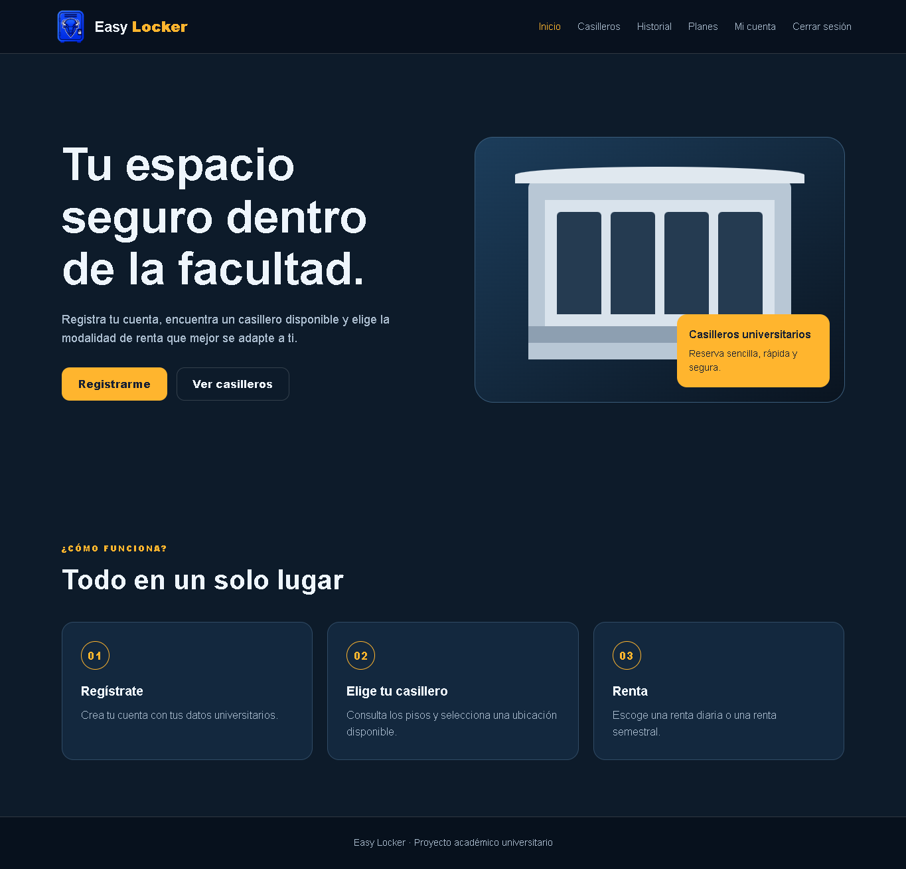

### 6.2 Registro — registro.html

Completa nombre, apellidos, matrícula, correo, facultad y contraseña. Envía el formulario; después inicia sesión con el correo registrado. El backend verifica los datos y la existencia de la facultad.

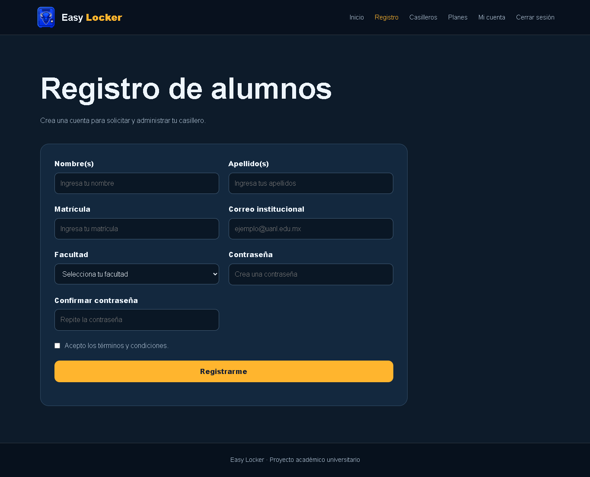

### 6.3 Inicio de sesión — login.html

Introduce correo y contraseña. La aplicación guarda temporalmente el token de sesión en el navegador y lo utiliza para solicitar recursos protegidos. Para cerrar sesión utiliza la opción correspondiente en la interfaz.

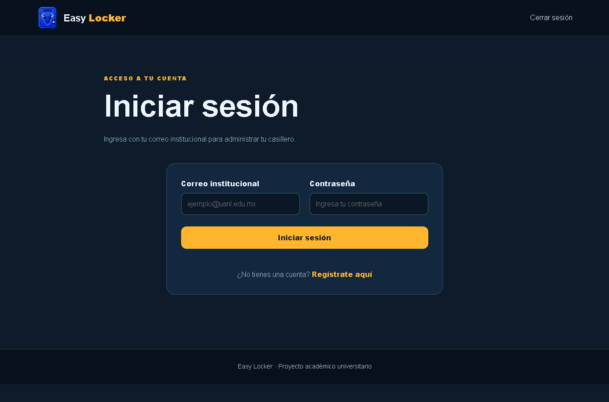

### 6.4 Casilleros — casilleros.html

Selecciona facultad, edificio y piso. Observa el mapa de casilleros y elige uno disponible. Los ocupados o no disponibles no pueden reservarse. La selección se usa en el proceso de renta.

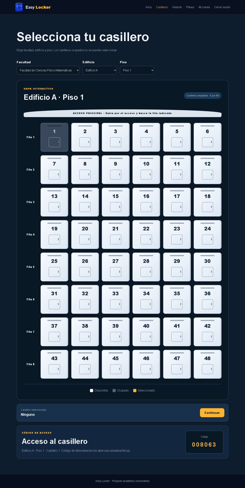

### 6.5 Planes — planes.html

Revisa la renta diaria y la semestral, sus precios y condiciones. Elige **Suscribirse** para continuar con el plan. Los precios definitivos de la operación se consultan desde la API.

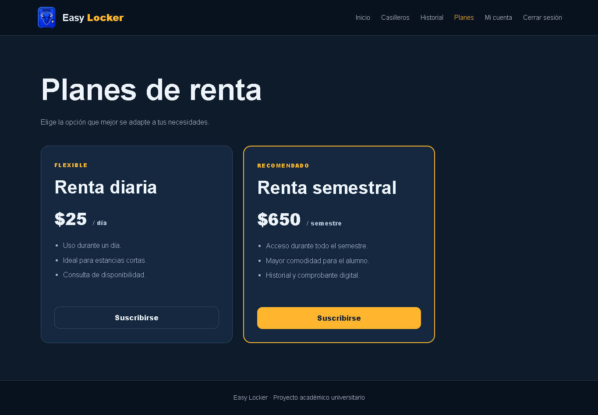

### 6.6 Pago simulado — Pago.html

Comprueba el resumen de plan y casillero. Pulsa **Confirmar pago simulado** para activar la reserva. No introduzcas información bancaria: la pantalla no procesa pagos reales. Una reserva pendiente caduca a los 15 minutos.

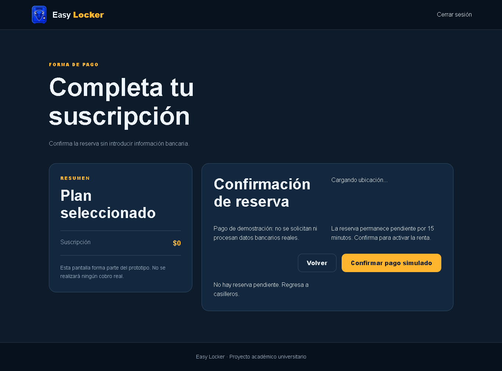

### 6.7 Mi cuenta — cuenta.html

Consulta nombre, correo, facultad, casillero y plan. Cuando hay una renta activa se muestra un código demostrativo de seis dígitos. El formulario de la misma página permite actualizar los datos personales.

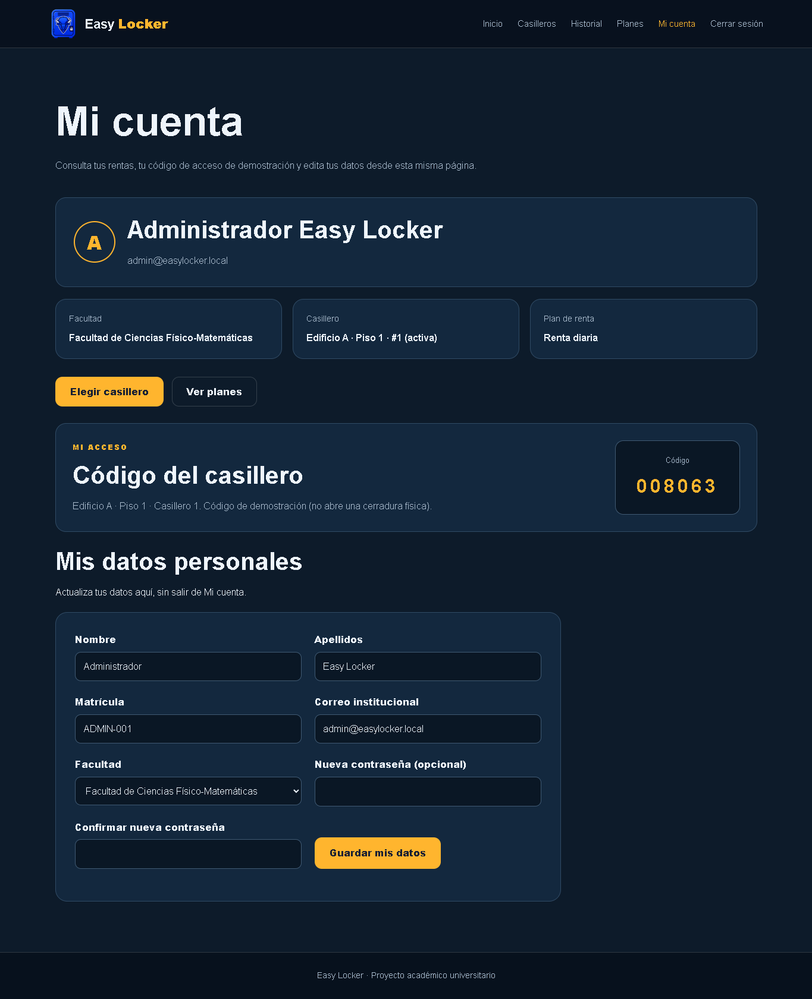

### 6.8 Historial — Historial.html

Consulta las rentas registradas, su estado, ubicación, plan y fechas. El resumen muestra la renta actual y el total de rentas.

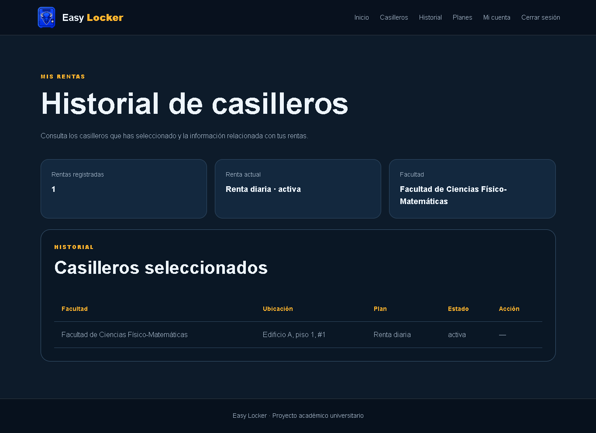

## 7. Manual de administración — Admin.html

Inicia sesión con una cuenta de rol **administrador**. Abre `Admin.html`. El panel muestra casilleros, disponibles, usuarios, rentas e ingresos simulados.

1. En **Colección**, selecciona la entidad.
2. Para crear, completa el formulario y pulsa **Crear registro**.
3. Para modificar, elige **Editar** en una fila, actualiza los campos y guarda.
4. Para eliminar, usa **Eliminar**; el backend impedirá borrar registros con dependencias.
5. Para consultar datos actualizados pulsa **Actualizar**.
6. Revisa los cuatro reportes de ocupación, ingresos, rentas por plan e historial.

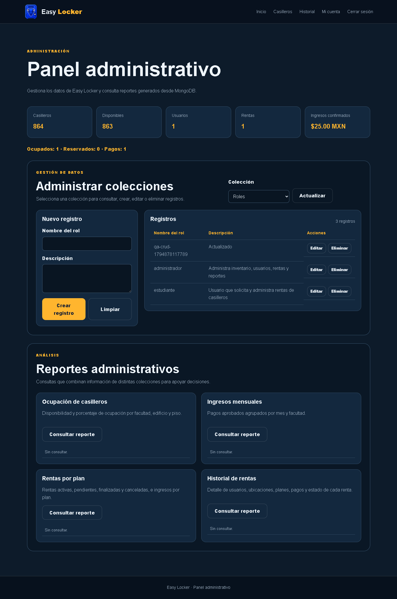

## 8. Uso en móvil

La interfaz incluye navegación adaptable. Se verificó la carga de las nueve páginas a una anchura simulada de 390 píxeles y no se detectaron errores JavaScript ni desbordamiento horizontal.

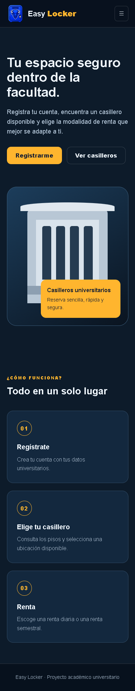

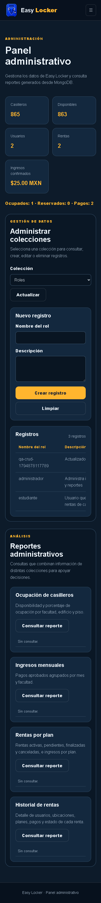

## 9. Instalación y ejecución

1. Instalar Node.js 20+ y ejecutar `npm install`.
2. Crear `.env` a partir de `.env.example` y configurar la URI privada de MongoDB Atlas, secretos JWT y credenciales administrativas.
3. Configurar acceso de red del clúster en Atlas.
4. Ejecutar una vez `npm run seed`.
5. Ejecutar `npm start` y abrir `http://localhost:3000`.
6. Ejecutar `npm test` y `npm run test:crud` para comprobar integración y CRUD.

**Seguridad:** no compartir `.env`, `atlas-credentials.env`, contraseñas ni tokens. Los archivos de credenciales están excluidos de Git.

## 10. Estado de entrega y límites

La aplicación funciona con Atlas y se aprobaron las pruebas automatizadas de integración. Sigue pendiente la validación del profesor sobre el uso de **Mongoose (ODM)** frente a la exigencia textual de **ORM**, y sobre `models.js` + `seed.js` como equivalente del script SQL solicitado. También debe completarse la lista de integrantes y verificar el historial de commits/ramas en GitHub.

**Capturas:** generadas con navegador Microsoft Edge en modo automatizado sobre la versión local. Algunas pantallas pueden mostrar datos de demostración o estados vacíos; no representan cobros reales.
